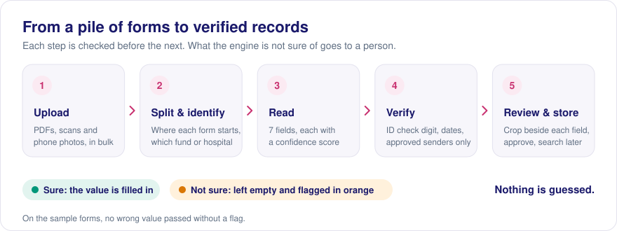

# LabExtract

**Commitment forms in, verified records out.** LabExtract reads the commitment forms (טופסי התחייבות) that reach
the Central Virology Laboratory of the Israeli Ministry of Health - printed, scanned, photographed or handwritten -
and turns them into structured records. Every field it is not sure of is marked for review. Nothing is guessed.

**Live demo:** [labextract-3qetzizcdmhmusfcfibefj.streamlit.app](https://labextract-3qetzizcdmhmusfcfibefj.streamlit.app/)



## What it does

- **Batch upload** - PDFs with many forms, scans (TIFF) and phone photos, in one drop.
- **Splits and identifies** - finds where each form starts and which health fund or hospital sent it.
- **Extracts 7 fields** - first and last name, ID number, central numbers, received date, sending entity and
  commitment numbers (several central or commitment numbers per form are kept).
- **Checks, never guesses** - ID check digit, date normalization, a closed list of approved senders. A missing or
  uncertain field stays empty and is marked in orange.
- **Review in place** - one row per commitment; each field shows the crop of the form it was read from, next to an
  edit box. Fix, approve, done.
- **Saved and searchable** - every record is stored in the system's database: search, filter, approved vs. pending,
  reopen any form. Excel export is optional.
- **Archive assistant** - a side chat on every screen answers questions in Hebrew ("כמה טפסים ממתינים לבדיקה?",
  "אילו טפסים חסר בהם מספר התחייבות?"). Answers are computed from the stored records, show their source and time,
  and the assistant says it did not understand rather than invent an answer.

## How it works

```
upload → page images (deskew, contrast) → split into forms → form type + fields with confidence
       → second read of uncertain numbers and names → validation → review → database
```

A multimodal model (Claude API) reads the page; code decides what is accepted. Built with Python, Streamlit,
Pillow / OpenCV, Poppler and SQLite.

## Using it

1. **Upload** - drag in the day's forms and press **חלץ נתונים**.
2. **Summary** - a table with one row per commitment; orange cells need a look. Click a row.
3. **Review** - compare each value with its crop, fix the orange fields, press **אשר טופס ועבור לבא**.
4. **Database** - search and filter all records, or ask the assistant (the round button, bottom left).

## Run locally

Requires Python 3.10+ and Poppler (Windows: add Poppler's `bin` folder to PATH or set `POPPLER_PATH` in `.env`;
macOS `brew install poppler`; Linux `apt install poppler-utils`).

```bash
python -m venv .venv
.venv/Scripts/activate                  # macOS / Linux: source .venv/bin/activate
pip install -r requirements.txt
cp .env.example .env                    # set CLAUDE_API_KEY
streamlit run app.py --server.address localhost
pytest                                  # tests, no API calls
```

## Deploy (Streamlit Community Cloud)

Create an app from this repository (`main`, `app.py`, Python 3.12) and add the key under Settings → Secrets:
`CLAUDE_API_KEY = "..."`. Poppler is installed from `packages.txt`. A form costs about $0.15-0.30 to process;
set a spend limit on the API account.

## Privacy

- Only the form images are sent to the model; the assistant sends only the question text, never records.
- Uploaded files are deleted after extraction; nothing personal is written to logs.
- Records stay in the system's database until deleted manually (per record, images only, or everything).
- On a public deployment, upload only the fictitious sample forms.

## Limitations and next steps

- Handwritten names are the hardest field; unreadable names stay empty with an unverified suggestion.
- The approved-senders list must be verified against the Ministry of Health list of medical institutions.
- For production the lab needs a retention policy, disk encryption, an agreement for sending images to the model
  provider, and an API into the lab's own system.

More detail - settings, pipeline, evaluation tooling: [docs/TECHNICAL.md](docs/TECHNICAL.md).
